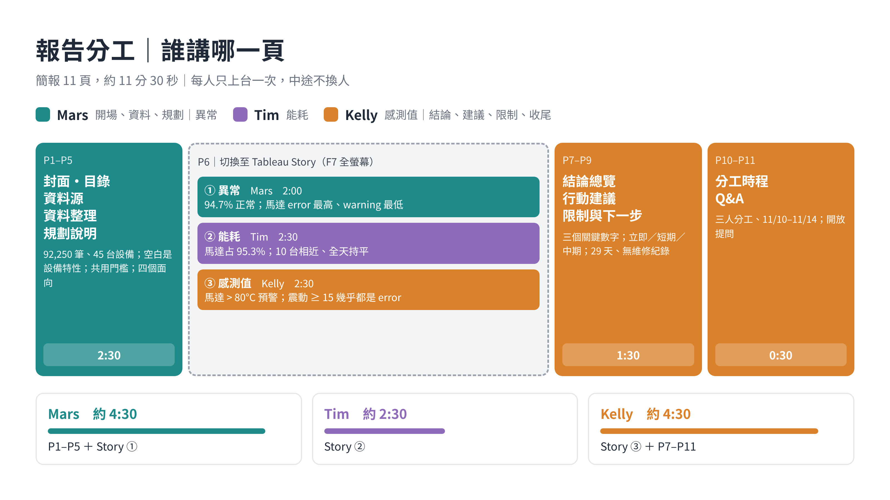
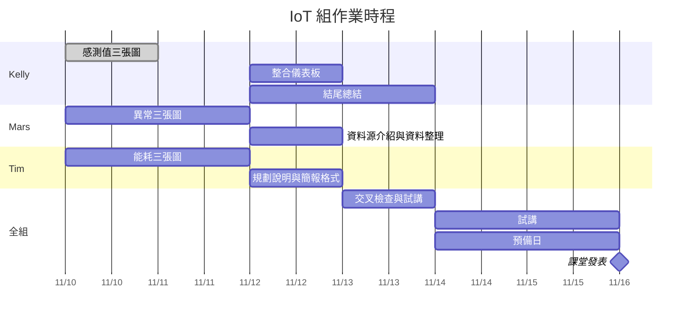

# IoT 設備感測資料分析｜Tableau 分組作業

IoT 組（Mars、Tim、Kelly）。用 Tableau 對工廠 IoT 設備感測資料做**描述性分析**，整合成儀表板，**11/16（一）早上課堂發表**。

- 報告對象：工廠設備維運主管（想知道哪些設備有風險、電耗在哪裡）
- 目標：11/13（五）全部完成，11/14–11/15 只做模擬演練、預備日

## 文件連結

- 報告與說明（HackMD）：https://hackmd.io/@Yihsuanchen1/SJljDOTTfg/https%3A%2F%2Fhackmd.io%2FCkvrlWlvTF2aL6aYtM8VPw%2Fpublish
- 簡報（Gamma）：https://gamma.app/docs/IoT-29--v4mdquwjqyodgdx

## 資料來源

| 項目 | 內容 |
|---|---|
| 資料集 | Antdata 時間序列資料集：IoT／製造業感測器紀錄（`iot_sensor_logs`） |
| 資料量 | 92,250 筆、11 欄、45 台設備（每台 2,050 筆） |
| 時間範圍 | 2025-01-01 ～ 2025-01-29（29 天） |
| 設備類型 | 溫度感測器 41,000 筆、壓力計 30,750 筆、馬達 20,500 筆 |
| 狀態 | normal 94.7%、offline 2.0%、warning 1.9%、error 1.4% |
| 資料檢查 | 無重複；pressure、vibration_level 的空白是設備本來沒有該量測，不是錯誤；最終使用 92,250 筆（全部保留） |

資料庫連線帳密不放進本 repo。

## 資料稽核

報告中的所有關鍵數字，都以 Python 從原始資料重新計算並逐項比對，**61 / 61 項通過**。

| 稽核項目 | 檢查數 | 結果 |
|---|---:|---|
| 基礎資料量與缺值 | 13 | ✅ |
| 面向一：異常比例 | 16 | ✅ |
| 面向二：能耗分布 | 15 | ✅ |
| 面向三：感測值門檻 | 17 | ✅ |
| 交叉稽核：邏輯一致性 | — | ✅ 無矛盾 |

- 稽核報告：[`稽核/資料稽核報告.md`](稽核/資料稽核報告.md)
- 稽核程式：[`稽核/iot_data_audit.py`](稽核/iot_data_audit.py)（`pip install pandas` 後執行 `python iot_data_audit.py` 即可重現）
- 執行紀錄：[`稽核/稽核結果_20261114.txt`](稽核/稽核結果_20261114.txt)

## 分工

| 成員 | 分析面向 | 圖表 | 報告負責 |
|---|---|---|---|
| Mars | 異常 | 狀態比例、設備類型異常比例、異常設備排行 | 開場、資料源介紹、資料整理、規劃說明 |
| Tim | 能耗 | 設備類型耗電、耗電前十名、馬達時段耗電 | 簡報格式與配色 |
| Kelly | 感測值 | 馬達溫度分布、過熱紀錄排行、壓力與震動 | Tableau 儀表板與故事整合、結論與建議、限制、分工時程、結尾總結 |

每張圖講三句：①這張圖在比什麼　②看到什麼（一個具體數字）　③對維運主管代表什麼。

整合主檔時的工作表名稱對照、配色變更與統一規則，見 [`彙整版/彙整說明.md`](彙整版/彙整說明.md)。

## 報告分工

每人只上台一次，中途不換人。簡報（Gamma）共 11 頁，總長約 11 分 30 秒；逐字稿見 [`彙整版/簡報逐字稿_V1.md`](彙整版/簡報逐字稿_V1.md)。



| 順序 | 報告人 | 段落 | 時間 |
|---|---|---|---|
| 1 | Mars | P1 封面・P2 目錄 → P3 資料源介紹 → P4 資料整理 → P5 規劃說明 → Tableau Story ① 異常 | 約 4:30 |
| 2 | Tim | Tableau Story ② 能耗 | 約 2:30 |
| 3 | Kelly | Tableau Story ③ 感測值 → P7 結論總覽 → P8 行動建議 → P9 限制與下一步 → P10 分工時程 → P11 Q&A | 約 4:30 |

P6 為「實機儀表板展示」，由 Mars 從此頁切換至 Tableau（F7 全螢幕），③ 講完後由 Kelly 切回 Gamma P7。

## 時程



| 日期 | 事項 | 負責 | 狀態 |
|---|---|---|---|
| 11/10（二） | 共用定義、計算欄位；能耗、感測值圖表 | Tim、Kelly | ✅ 完成 |
| 11/11（三） | 第 1 次小組會議：確認分工與時程 | 全組 | ✅ 完成 |
| 11/12（四） | HackMD 分析文字 | 全組 | ✅ 完成 |
| 11/13（五） | 異常圖表完成；彙整 3 個儀表板與故事，上傳 GitHub | Mars、Kelly | ✅ 完成 |
| 11/14（六） | 第 2 次小組會議；全組試講計時；資料稽核 | 全組 | ✅ 資料稽核完成 |
| 11/15（日） | 預備日：最後檢查、定稿 | 全組 | |
| 11/16（一） | 課堂發表（用講師電腦） | 全組 | |

## Repo 結構

```
iot-tableau-group/
├─ README.md
├─ kelly/    Kelly 的 .twbx、截圖
├─ mars/     Mars 的 .twbx、截圖
├─ tim/      Tim 的 .twbx、截圖
├─ 彙整版/   全組整合的 .twbx（儀表板＋故事）與彙整說明
├─ 稽核/     資料稽核報告、稽核程式與執行紀錄
└─ docs/     講稿、簡報、HackMD 稿
```

## 共用規則

1. **每人只改自己的資料夾**，這樣不會有檔案衝突。
2. **.twbx 一律存「擷取」版**（資料來源頁改成擷取），避免換電腦圖表變空白。存檔前不要把密碼寫進檔案。
3. 工作表命名：`工作表_負責人_主題`，例如 `工作表_Kelly_馬達溫度分布`。
4. 檔名加日期：`Kelly_感測值_1111.twbx`。
5. 圖表標題寫成「結論」，不要只寫圖名。
6. 數字說「紀錄筆數」，不說「次數」；說「關聯」，不說「造成」。
7. 卡關超過 1 小時，立刻丟群組。
8. 本 repo 為 private，繳交前再決定是否公開。
9. 定稿文件用檔名標示版本：`檔名_V1`、`檔名_V2`……；改版時另存新版本，不覆蓋舊檔，README 的連結指向最新版。

## 每天的操作

開始工作前：

```bash
git pull
```

放入檔案後：

```bash
git add 自己的資料夾/
git commit -m "說明這次做了什麼"
git push
```

`push` 被拒絕時，先 `git pull`，再 `git push`。

## 待確認

- [ ] 報告時間長度
- [ ] 報告分配段落
- [ ] 11/14晚上模擬報告
- [ ] 繳交日期與繳交方式（HackMD／簡報／Gamma）
- [ ] 主檔 `備用_能耗平均每筆`：欄位仍為「總和」，需改為「平均值」（欄上右鍵 →「度量」→「平均值」）。此表為備用圖，不影響儀表板與故事
