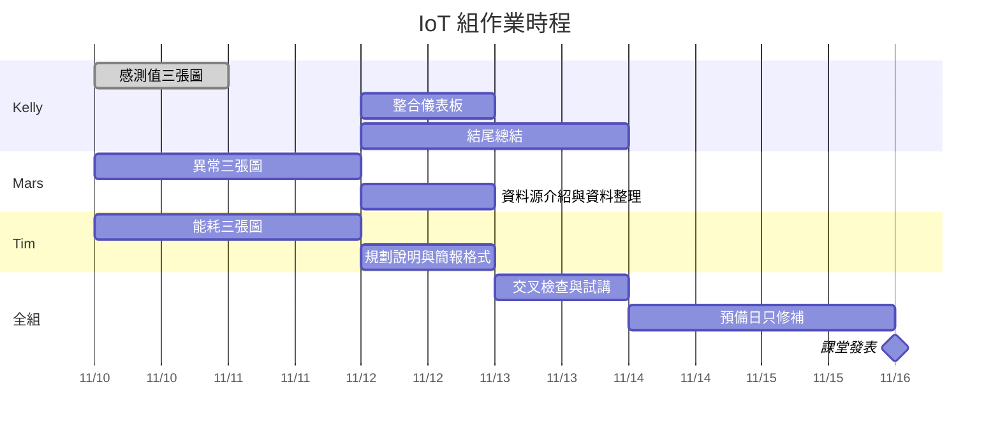

# IoT 設備感測資料分析｜Tableau 分組作業

IoT 組（Mars、Tim、Kelly）。用 Tableau 對工廠 IoT 設備感測資料做**描述性分析**，整合成儀表板，**11/16（一）早上課堂發表**。

- 報告對象：工廠設備維運主管（想知道哪些設備有風險、電耗在哪裡）
- 目標：11/13（五）全部完成，11/14–11/15 只做預備修補

## 文件連結

- 報告與說明（HackMD）：https://hackmd.io/@Yihsuanchen1/SJljDOTTfg/https%3A%2F%2Fhackmd.io%2FCkvrlWlvTF2aL6aYtM8VPw%2Fpublish
- 簡報：（之後補）

## 資料來源

| 項目 | 內容 |
|---|---|
| 資料集 | Antdata 時間序列資料集：IoT／製造業感測器紀錄（`iot_sensor_logs`） |
| 資料量 | 92,250 筆、11 欄、45 台設備（每台 2,050 筆） |
| 時間範圍 | 2025-01-01 ～ 2025-01-29（29 天） |
| 設備類型 | 溫度感測器 41,000 筆、壓力計 30,750 筆、馬達 20,500 筆 |
| 狀態 | normal 94.7%、offline 2.0%、warning 1.9%、error 1.4% |
| 資料檢查 | 無重複；pressure、vibration_level 的空白是設備本來沒有該量測，不是錯誤；最終使用 92,250 筆（全部保留） |

資料庫連線帳密不放進本 repo。

## 分工

| 成員 | 負責的圖表（自己上台講） | 另外負責 | 資料夾 |
|---|---|---|---|
| Mars | 異常分析：狀態比例、機器種類 × 異常比例、異常機器排行 | 資料源介紹、資料整理 | `mars/` |
| Tim | 能耗：各機器種類耗電比較、耗電排行、時段趨勢 | 規劃說明、簡報統一格式與配色 | `tim/` |
| Kelly | 感測值：馬達溫度分布、過熱次數排行、壓力與震動 | 整合儀表板、保管主檔、分工與時程、結尾總結 | `kelly/` |

每張圖講三句：①這張圖在比什麼　②看到什麼（一個具體數字）　③對維運主管代表什麼。

## 時程



| 日期 | 事項 |
|---|---|
| 11/10–11/11 | 各人完成 3 張圖。**最低線：11/11 晚前每人至少 2 張推到自己的資料夾** |
| 11/12（四） | Kelly 整合儀表板；資料源介紹、資料整理、規劃說明定稿；各人做自己的簡報頁 |
| 11/13（五）**完成日** | 講稿完成、三人交叉檢查數字、全組試講計時、另一台電腦開啟測試、備份 PDF |
| 11/14–11/15 | 預備日，只修補，不加新內容 |
| 11/16（一）早上 | 課堂發表（用講師電腦） |

## Repo 結構

```
iot-tableau-group/
├─ README.md
├─ kelly/    Kelly 的 .twbx、截圖
├─ mars/     Mars 的 .twbx、截圖
├─ tim/      Tim 的 .twbx、截圖
└─ docs/     講稿、簡報、HackMD 稿
```

## 共用規則

1. **每人只改自己的資料夾**，這樣不會有檔案衝突。
2. **.twbx 一律存「擷取」版**（資料來源頁改成擷取），避免換電腦圖表變空白。存檔前不要把密碼寫進檔案。
3. 工作表命名：`工作表_負責人_主題`，例如 `工作表_Kelly_馬達溫度分布`。
4. 檔名加日期：`Kelly_感測值_1111.twbx`。
5. 圖表標題寫成「結論」，不要只寫圖名。
6. 數字說「紀錄筆數」，不說「次數」；說「關聯」，不說「造成」。
7. 卡關超過 1 小時，立刻丟群組。
8. 本 repo 為 private，繳交前再決定是否公開。

## 每天的操作

開始工作前：

```bash
git pull
```

放入檔案後：

```bash
git add 自己的資料夾/
git commit -m "說明這次做了什麼"
git push
```

`push` 被拒絕時，先 `git pull`，再 `git push`。

## 待確認

- [ ] 老師規定的報告時間長度
- [ ] `vibration_level` 的單位，以及 `status` 的判定規則（是否依感測值門檻）
- [ ] 設備是否有規格上的溫度、震動警戒值
- [ ] 繳交日期與繳交方式（HackMD／簡報／Gamma）
