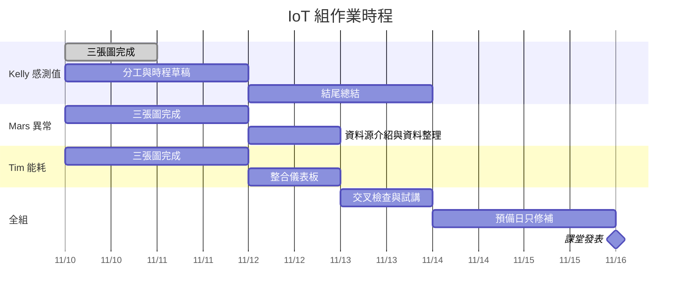

# Tableau 分組作業
- 產業主題:IoT
- 團隊成員:Kelly、Mars、Tim
- 報告日期:2026/11/16
- 小組資料連結:[github](https://github.com/KellyChen413/iot-tableau-group.git)
- ==簡報連結== 
---
## 題目
- [資料源](https://pair.tw/antdata/)

- 題目要求
1.針對資料進行描述性分析  
2.各組報告內容，除製作分析圖表並彙整到儀表板或story，還需包含 :  
a.資料源介紹 (包含資料內容、資料量)  
b.資料整理 (確認資料正確性、最終使用資料量)  
c.規劃說明的對象，以什麼面向進行分析  
d.工作分工與時程  
3.除儀表板或story可準備簡報或是HackMD、Gamma等線上工具進行其他內容說明
**由於尚未介紹Tableau public，報告當天可直接轉出檔案使用講師電腦報告**

---
### 前置環境準備
- 安裝SQL [下載](https://dev.mysql.com/downloads/connector/odbc/)

----

## 一、資料源介紹：工廠設備的 29 天紀錄

- **來源**：PAIR Antdata 時間序列資料集（https://pair.tw/antdata/），資料表 `iot_sensor_logs`
- **內容**：工廠設備感測器定時回報的溫度、壓力、震動、耗電與狀態
- **資料量**：92,250 筆 × 11 欄，45 台設備，每台 2,050 筆
- **期間**：2025/01/01 – 2025/01/29（1/29 只到 11:57）

**▍資料欄位**

| 類別 | 欄位 | 說明 |
|---|---|---|
| 識別 | `log_id` | 紀錄編號 |
| | `device_id`、`device_type` | 設備編號、設備類型 |
| | `factory_zone` | 廠區 |
| | `timestamp`、`created_at` | 量測時間、寫入時間 |
| 感測值 | `temperature` | 溫度（°C） |
| | `pressure` | 壓力（只有壓力計有） |
| | `vibration_level` | 震動程度（馬達、壓力計有） |
| | `power_consumption` | 耗電值（未提供單位） |
| 狀態 | `status` | normal／warning／error／offline |

**▍設備組成**

| 設備類型 | 台數 | 筆數 |
|---|---:|---:|
| 馬達（motor） | 10 | 20,500 |
| 壓力計（pressure_gauge） | 15 | 30,750 |
| 溫度感測器（temperature_sensor） | 20 | 41,000 |

**▍狀態分布**

| 狀態 | 說明 | 筆數 | 比例 |
|---|---|---:|---:|
| normal | 正常 | 87,354 | 94.7% |
| offline | 離線（沒回報） | 1,801 | 2.0% |
| warning | 警告（有徵兆） | 1,764 | 1.9% |
| error | 錯誤（出問題） | 1,331 | 1.4% |
| **合計** | | **92,250** | **100%** |

## 二、資料整理

| 檢查項目 | 結果 | 建議處理 |
|---|---|---|
| 重複 | log_id 與整列都沒有重複 | 不用處理 |
| 缺值：pressure | 61,500 筆空白（只有壓力計 30,750 筆有值） | 不是錯誤，是設備本來沒有此量測；圖表只用壓力計 |
| 缺值：vibration_level | 41,000 筆空白（溫度感測器沒有） | 同上，只用馬達與壓力計 |
| 其他欄位缺值 | 0 | 不用處理 |
| 時間 | 全部可解析；資料沒有依時間排序 | Tableau 以 timestamp 排序即可 |
| 時間邏輯 | timestamp 都早於 created_at（匯入時間 2026/11/1–2） | created_at 是匯入時間，分析不用 |
| 溫度極端值 | 馬達最高 109.06°C；>80°C 共 408 筆（全是馬達），>100°C 有 55 筆 | 先保留，當作「過熱」分析；報告寫明未刪除 |
| 耗電 | 無 0 或負值；馬達 5–50、壓力計 0.2–0.8、溫度感測器 0.1–0.5 | 不同量級，圖表要依設備類型分開看 |
| 廠區 factory_zone | 有 10 個值，兩套命名：A～D區、組裝區、測試區、加工區（量測設備），以及生產線1–3（只有馬達） | 見下方警告 |
| 最終使用筆數 | 建議 92,250（全部保留） | 若決定排除離群值，要寫明筆數與理由 |

- **最終使用資料量**：**92,250 筆全部保留**；各圖依需求篩選設備類型

## 三、規劃說明
- 對象：工廠設備維運主管
- 問題:哪些設備有風險、耗電在哪裡、什麼訊號代表快出問題？
- 分析面向：
  1. 整體概況：各設備類型數量、狀態比例。
  2. 異常狀態：哪類設備、哪幾台設備、哪個廠區最常異常。
  3. 能耗：各設備類型耗電比較、Top 設備、時段趨勢。
  4. 感測值分布：溫度、壓力的分布與離群值。

## 四、面向一：異常｜Mars

### 圖 1　[結論式標題]

- **看什麼**：
- **看到什麼**：
- **代表什麼**：

### 圖 2　[結論式標題]

- **看什麼**：
- **看到什麼**：
- **代表什麼**：

### 圖 3　[結論式標題]

- **看什麼**：
- **看到什麼**：
- **代表什麼**：

**小結**：

---

## 五、面向二：能耗｜Tim

### 圖 1　[結論式標題]

- **看什麼**：
- **看到什麼**：
- **代表什麼**：

### 圖 2　[結論式標題]

- **看什麼**：
- **看到什麼**：
- **代表什麼**：

### 圖 3　[結論式標題]

- **看什麼**：
- **看到什麼**：
- **代表什麼**：

**小結**：

---

## 六、面向三：感測值｜Kelly

> 問題：**什麼訊號代表設備快出問題？** 我看馬達的溫度與壓力計的震動

### 圖 1　馬達溫度大多在 30–80°C，過熱紀錄約占 2%

- **看什麼**：20,500 筆馬達紀錄的溫度分布，每 5°C 一格，橘色為 > 80°C
- **看到什麼**：30–80°C 每格約 2,000 筆，超過 80°C 驟降；過熱 **408 筆（約 2%）**，其中 55 筆超過 100°C，最高 109°C
- **代表什麼**：馬達平常運轉穩定，過熱是少數但溫度很高，不能忽略

---

### 圖 2　10 台馬達都有過熱紀錄，沒有集中在單一台馬達

- **看什麼**：408 筆過熱紀錄依馬達編號排名
- **看到什麼**：10 台全部都有，31–48 筆，最多為 **MOT004（48 筆）**；前 3 名只占約三分之一，且 29 天每天都有
- **代表什麼**：過熱不是單一設備的問題，**溫度監控要做在每一台馬達**

---

### 圖 3　壓力計震動 ≥ 15 時，98.5% 為 error

- 震動分組檢查表

- **看什麼**：壓力計 30,750 筆紀錄，橫軸壓力、縱軸震動，紅色為 error；再依震動分成低、中、高三組做檢查表
- **看到什麼**：紅點橫跨 1.0–5.0 各種壓力，與壓力高低沒有明顯關係；震動 ≥ 15 共 **130 筆，128 筆是 error（98.46%）**，沒有任何 normal；低、中震動的 error 只有約 1%
- **代表什麼**：**震動 ≥ 15 值得優先檢查**；但壓力計 407 筆 error 中有 279 筆（約 69%）發生在震動 < 15，震動是強訊號，不是唯一原因

**小結**：馬達要盯**溫度 > 80°C**（每台、每天都有），壓力計要盯**震動 ≥ 15**（幾乎都是 error）

---

## 七、儀表板

- 報告當天以講師電腦開啟 Tableau 檔案（.twbx）展示

----
## 八、工作分工與時程
## 分工

| 成員 | 負責項目 | 報告負責 | 
|---|---|---|
| Mars | 異常分析：狀態比例、機器種類 × 異常比例、異常機器排行 | 開場：資料源介紹、資料整理 | 
| Tim | 能耗：各機器種類耗電比較、耗電排行、時段趨勢 | 規劃說明 | 
| Kelly | 感測值：馬達溫度分布、過熱次數排行、壓力與震動 、 組織架構統整| 工作分工與時程、結尾總結 |

# 時程

目標：11/13（五）全部完成；11/16（一）早上課堂發表

| 日期 | 事項 | 負責 | 狀態 |
|---|---|---|---|
| 11/9（一）晚 | 開會：確認角色、資料決定、計算欄位寫法 | 全組 | 【待確認】 |
| 11/10（二） | 能耗、感測值圖完成並核對數字 | Tim、Kelly | 【已完成】 |
| 11/10–11/11 | 異常、能耗圖表完成 | Mars、Tim | 【待回報】 |
| 11/12（四） | Hackmd增加分析文字說明 | Tim／Mars／全組 |【Kelly已完成】 |
| 11/13（五）**完成日** | 規劃說明與分工時程定稿；講稿完成；交叉檢查數字；匯出 .twbx 並在另一台電腦開啟測試 | 全組 | |
| 11/14(六)晚| 第2次討論會議、全組試講計時 | 視需要 | |
| 11/15(日)| 預備日、最後檢查、定稿 | 全組 | |
| 11/16（一）早 | 課堂發表（用講師電腦） | 全組 | |

----
## 九、結論與建議

1. **異常**：
2. **能耗**：
3. **感測值**：震動 ≥ 15 的壓力計優先檢查；10 台馬達都要做溫度監控

**限制**：只有 29 天資料、沒有維修紀錄，只能描述「發生什麼」，不能說明原因

---

## Q&A
感謝聆聽 🙌