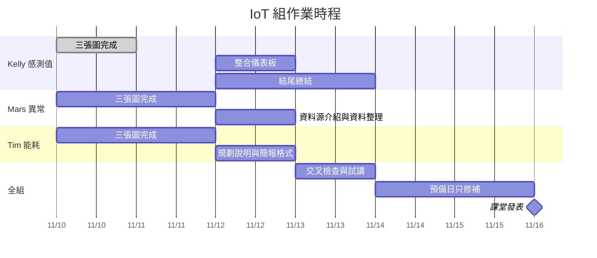

# Tableau 分組作業｜工作分工與時程＋結尾總結（草稿）

> 2026-11-10 由 9 號經理起草，供 Kelly 貼進 HackMD／簡報。
> 數字來源：`antdata_iot_sensor_logs_20261108_121225.csv`（92,250 筆）已用 pandas 重算，並與 Kelly.twbx 的三張圖核對。
> 【待填】是需要 Mars、Tim 回報的地方，我不替他們編數字。

---

# 一、工作分工與時程（可直接貼 HackMD）

## 1.1 分工

| 成員 | 負責的圖表（自己上台講） | 另外負責 | 交付物 |
|---|---|---|---|
| Mars | 異常分析：狀態比例、機器種類 × 異常比例、異常機器排行 | 開場：資料源介紹、資料整理 | 3 張異常工作表、資料整理說明 |
| Tim | 能耗：各機器種類耗電比較、耗電排行、時段趨勢 | 規劃說明、簡報統一格式與配色 | 3 張能耗工作表、規劃說明 |
| Kelly | 感測值：馬達溫度分布、過熱次數排行、壓力與震動 | 整合儀表板（保管 .twbx 主檔與 GitHub repo）、分工與時程、結尾總結 | 3 張感測值工作表（含 1 張檢查表）、整合儀表板、時程表、結語 |

**為什麼這樣分：** 三人各做一個分析面向（異常、能耗、感測值），圖表之間不互相等待；整合儀表板由 Kelly 負責（2026-11-10 Kelly 決定，【待 Mars、Tim 確認】），主檔與 repo 只有一個人保管，避免版本混亂。

**每張圖的講法：** 三句話——①這張圖在比什麼　②看到什麼（一個具體數字）　③對工廠維運主管代表什麼。

## 1.2 時程（目標：11/13（五）全部完成；11/16（一）早上課堂發表）

| 日期 | 事項 | 負責 | 狀態 |
|---|---|---|---|
| 11/9（一）晚 | 開會：確認角色、資料決定、計算欄位寫法 | 全組 | 【待確認】 |
| 11/10（二） | 感測值 3 張圖完成並核對數字 | Kelly | 已完成 |
| 11/10–11/11 | 異常 3 張、能耗 3 張完成，每張寫一句說明；**最低線：11/11 晚每人 2 張推到自己的資料夾（或交給 Kelly）** | Mars、Tim | 【待回報】 |
| 11/12（四） | 整合儀表板；資料源介紹、資料整理定稿；各人做自己的簡報頁 | Kelly／Mars／全組 | |
| 11/13（五）**完成日** | 規劃說明與分工時程定稿；講稿完成；交叉檢查數字；全組試講計時；匯出 .twbx 並在另一台電腦開啟測試 | 全組 | |
| 11/14–11/15 | 預備日：只修補問題，不加新內容 | 視需要 | |
| 11/16（一）早上 | 課堂發表（用講師電腦） | 全組 | |



（若 HackMD 沒畫出圖，檢查 ```mermaid 前後有沒有空行；仍不行就只貼上方表格。）

## 1.3 關鍵路徑與風險（PM 常用的寫法，小組作業寫 4 條就夠）

**關鍵路徑：** 各人圖表 → Kelly 整合儀表板 → 簡報定稿 → 試講。任何一環延誤，後面都會被擠壓，所以 11/11 設「每人 2 張」的最低線。

| 風險 | 影響 | 預防／備案 |
|---|---|---|
| .twbx 沒有內含資料（連線方式為即時連線） | 在講師電腦或組員電腦打不開、圖表空白 | 資料來源頁改成「擷取」後再存 .twbx；11/13 在另一台電腦開啟測試；備案：報告用截圖與 PDF |
| 組員進度落後 | 儀表板無法整合 | 11/11 最低線；卡關超過 1 小時立刻丟群組 |
| 數字對不上（簡報 vs 儀表板） | 被老師問倒 | 11/13 交叉檢查，三人互相核對；數字一律以資料庫或 CSV 重算為準 |
| 版本混亂（多人傳檔） | 覆蓋、遺失 | 單一主檔由 Kelly 保管；每人只改自己的資料夾（GitHub repo）；檔名加日期（例：`IoT組_主檔_1112.twbx`）；舊版放 `舊版` 資料夾 |
| 11/14–11/15 有個人考試 | 無人可修補 | 11/13 前完成，兩天只當預備日 |

## 1.4 共用規則

- 同一份資料來源，同一個 .twbx 主檔由 Kelly 保管，其他人交工作表（或獨立 .twbx）合併。
- 工作表命名：`工作表_負責人_主題`。
- 圖表標題寫「結論」，不要只寫圖名。
- 卡關超過 1 小時，立刻丟群組。
- 報告當天用講師電腦，事先存好 .twbx、PDF 與截圖三份備援。

---

# 二、結尾總結（草稿，11/13 三人圖表都完成後再定稿）

## 2.1 一句話結論

> 這批 IoT 設備資料整體穩定（94.7% 為正常），**風險集中在兩件事：馬達過熱，以及壓力計在震動 ≥15 時幾乎都是 error；而馬達同時佔了 95% 的耗電，是維運與節能都最值得優先關注的設備。**

## 2.2 三個發現（各自對應一位組員）

| 面向 | 發現 | 數字 | 來源 |
|---|---|---|---|
| 異常（Mars） | 整體正常；馬達的 error 比例最高 | 正常 94.7%；error 比例：馬達 1.88%、壓力計 1.32%、溫度感測器 1.31% | pandas 重算，【請與 Mars 的圖核對】 |
| 能耗（Tim） | 耗電高度集中在馬達 | 馬達占總耗電約 95.3%；每筆平均 27.5，壓力計 0.5、溫度感測器 0.3 | pandas 重算，【請與 Tim 的圖核對】 |
| 感測值（Kelly） | 馬達過熱少但分散；壓力計震動 ≥15 時幾乎都是 error | 過熱 408 筆（約 2%）、10 台都有（31–48 筆）；震動 ≥15 的 130 筆中 128 筆為 error（98.5%），其他範圍約 1% | pandas 重算；**圖 3 分組門檻要由 14 改成 15（見下方第三節）** |

## 2.3 建議（給維運主管）

1. **馬達溫度監控以「全部 10 台」為單位，不鎖定單一設備。** 過熱分散在所有馬達，前三名只佔約 34%。
2. **把壓力計「震動 ≥15」列為優先檢查條件。** 這個範圍 130 筆中有 128 筆是 error（98.5%），其他範圍只有約 1%。但全部 407 筆 error 中仍有約 69% 發生在低震動，所以還需要別的指標。
3. **節能與保養優先放在馬達。** 馬達耗電占 95%，一點改善的效益最大。

## 2.4 限制（結尾一定要講，這是專業的表現）

- 這是**描述性分析**，只描述「發生了什麼」，不證明原因。
- 「筆數」是紀錄筆數，不等於獨立事件數；連續幾筆過熱可能是同一次事件。
- 80°C 與震動的 2、15 是我們依資料分布自訂的分析門檻，**不是設備規格**。
- 震動 ≥15 的 130 筆裡沒有任何 normal 或 warning（128 筆 error、2 筆 offline），分界太乾淨，**推測 `status` 可能就是依震動門檻判定**。若是這樣，「高震動 → error」比較像是定義，不是新發現。這點要問老師。
- 資料只有 29 天（2025/1/1–1/29），無法判斷季節或長期趨勢。
- 廠區與設備不是一對一，所以不做設備位置的結論。

## 2.5 下一步（若有更多資料）

1. 向設備方確認 `vibration_level` 的單位，以及 `status` 的判定規則。
2. 取得維修紀錄，驗證過熱與震動是否真的對應到故障。
3. 把連續紀錄合併成「事件」，再算次數與持續時間。
4. 進一步做預警與預測（進入預測性維護）。

## 2.6 結尾口述稿（約 40 秒）

> 最後整理三件事。第一，這批設備整體穩定，九成四以上的紀錄是正常。第二，風險有兩個：馬達過熱，雖然只有約 2%，但十台馬達都有；壓力計在震動 15 以上時，一百三十筆裡有一百二十八筆是 error，其他範圍只有約 1%。第三，馬達耗掉整體約 95% 的電，所以不管是保養或節能，優先看馬達最划算。
>
> 要提醒的是，我們做的是描述性分析，看得到關聯，但不能直接說因果；80 度和震動的分組門檻，也是我們依資料分布設定的，實際要看設備規格；而且高震動幾乎全是 error，可能是狀態本來就依震動判定，這要向資料提供方確認。如果有維修紀錄，我們可以進一步驗證這些風險。謝謝大家。

---

# 三、兩件要先處理的事

## 3.1 圖 3 的門檻要由 14 改成 15（我先前給的 14 是目視估的，重算後修正）

用原始 CSV 重算壓力計 30,750 筆：震動 14–15 之間有 95 筆、**零筆 error**；error 全部出現在 ≥15。

| 震動分組 | 筆數 | error | error 比例 |
|---|---|---|---|
| 低（<2） | 29,752 | 270 | 0.91% |
| 中（2–<15） | 868 | 9 | 1.04% |
| 高（≥15） | 130 | 128 | 98.5% |
| 合計 | 30,750 | 407 | |

**Tableau 操作：** 編輯計算欄位 `震動分組`，把 `14` 改成 `15`，名稱改成 `中(2–15)`、`高(≥15)`；檢查表重新看一次，合計仍應為 30,750。圖 3 標題改為：

```
壓力計震動 ≥15 時，130 筆中 128 筆為 error（98.5%）；其他範圍僅約 1%
```

## 3.2 Kelly.twbx 目前沒有內含資料

我解開了 `Kelly.twbx`，裡面只有 `Kelly.twb`（約 360 KB），**沒有 Data 資料夾**。連線設定是 MySQL **即時連線**（伺服器 `dv109.pair.tw`、埠 23306、帳號 `antdata`，沒有密碼欄位）。

**後果：** 檔案換到沒有裝 MySQL ODBC 驅動、或連不到資料庫的電腦（例如講師電腦），圖表會是空的。

**處理：**
1. Tableau 左下「資料來源」頁 → 右上連線選項改成「**擷取**」→ 回到工作表 → 檔案 → 另存新檔 → Tableau 封裝活頁簿（.twbx）。擷取後檔案會變大（約幾 MB）。
2. 存好後關掉 Tableau 再重新開啟 .twbx，確認圖表都在、不會跳出要求輸入資料庫密碼；11/13 再拿到另一台電腦測試一次。
3. 另外存一份 PDF（檔案 → 列印成 PDF）與三張截圖，當作備援。

**同時處理：**
- 存檔前把「備用-壓力與震動_Kelly」那張工作表刪掉，或改名加 `_舊` 並不交給 Tim，避免整合時混亂。
- 目前檔案裡三張圖的標題仍是預設的「壓力與震動」「過熱次數排行」「馬達溫度分布」，你剛改的結論式標題**重新存檔後才會進檔案**。
- 「壓力與震動_Kelly 」工作表名稱尾端多了一個空格，可改名拿掉。
